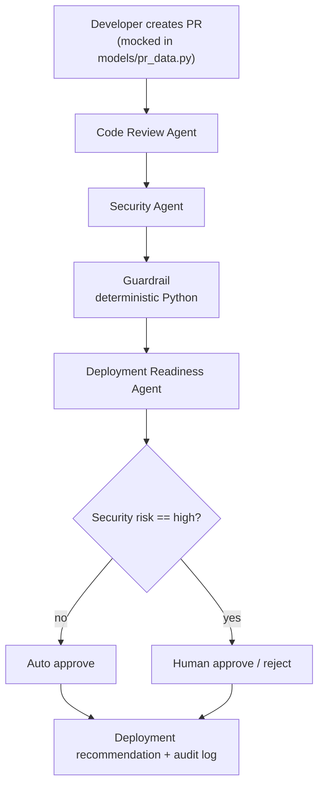
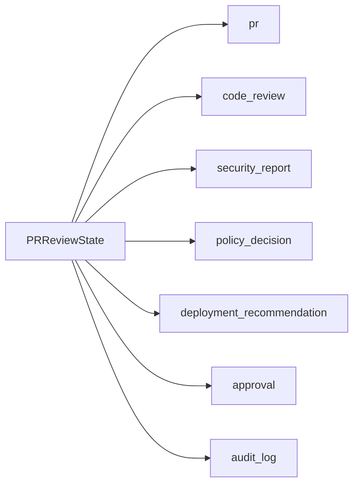

# AI Security PR Review Orchestrator

A small **Agent-to-Agent (A2A)** demo for AI-assisted DevOps: a mocked pull request is reviewed by three agents, then a **deterministic** security policy, then a human approval gate.

No GitHub account. No API key. Run it and watch each node print what it received and what it wrote.

## Why this exists

Platform teams already use CI/CD gates (tests, SAST, approvals). This project shows the same idea with agents:

1. Agents can **read each other's structured output** (A2A via shared state).
2. An LLM-style agent can *suggest*. **Python policy decides** deploy / no-deploy.
3. High risk still needs a **human**.

## Project layout

```
ai-security-pr-review-orchestrator/
  agents/
    code_review_agent.py
    security_agent.py
    deployment_agent.py
  guardrails/
    policy_engine.py
  models/
    state.py
    pr_data.py          # mocked PRs
    debug.py            # print helpers used while you step through
    audit.py
  workflow/
    graph.py
  main.py
  requirements.txt
```

## Architecture



Shared state (the A2A bus):



## Agent-to-Agent communication

Agents do **not** call each other as functions.

LangGraph keeps one `PRReviewState` dict. Each node:

1. **Reads** keys written by earlier nodes.
2. **Returns a patch** (only the keys it owns).
3. LangGraph **merges** that patch into state.

Example: Security Agent starts by printing `state["code_review"]`. That JSON is the handoff from the Code Review Agent.

## LangGraph state flow

Wired in `workflow/graph.py`:

```
START → code_review → security → guardrail → deployment → human_approval → END
```

| Node | Writes | Reads |
| --- | --- | --- |
| `code_review` | `code_review` | `pr` |
| `security` | `security_report` | `pr`, `code_review` |
| `guardrail` | `policy_decision` | `security_report` |
| `deployment` | `deployment_recommendation` | all of the above |
| `human_approval` | `approval` | `security_report`, `human_decision` |

Every node also appends to `audit_log`.

While debugging, set a breakpoint inside any node and inspect `state`. The terminal banners (`NODE: ...`) match graph node names.

## Deterministic vs probabilistic

| Kind | In this repo | Rule |
| --- | --- | --- |
| **Probabilistic** (agent-like) | Code Review, Security, Deployment nodes | Heuristics that *could* be swapped for an LLM later. Output is a Pydantic model, not free text. |
| **Deterministic** | `guardrails/policy_engine.py` + secret/CVE tools | Same input → same allow/block. **No LLM decides policy.** |

Guardrail rules:

- Critical vulnerability → **block**
- Hardcoded secret → **block**
- Risk `low` or `medium` → **continue** (unless a block rule already fired)

Human approval is separate:

- `risk == high` → approval required (`--approve` / `--reject`)
- otherwise → auto approve

## Security guardrails

`evaluate_policy()` is plain if-statements on flags the Security Agent set:

- `has_hardcoded_secret`
- `has_critical_vulnerability`

Secret scanning and dependency checks are regex + denylist tools (`scan_secrets`, `check_dependencies`). They are deterministic so you can unit-test them the same way you test a CI quality gate.

## Human approval workflow

`human_approval_node` does not call `input()` (that would hang in some IDEs). `main.py` passes `human_decision`:

- default `auto` → high-risk PRs stay `pending`
- `--approve` / `--reject` simulate a person on the change board

That mirrors a real pipeline: bot posts findings, human clicks Approve on the deploy gate.

## Setup

From this folder, using the existing workspace venv or a new one:

```bash
cd ai-security-pr-review-orchestrator
python3 -m venv .venv
source .venv/bin/activate   # Windows: .venv\Scripts\activate
pip install -r requirements.txt
```

If you already have LangGraph + Pydantic in `/Users/alekhyaakkiraju/python-projects/venv`, you can run with that interpreter instead.

## Run

```bash
# Default: risky PR (secret + outdated packages). Approval stays pending.
python main.py

# Same PR, human approves
python main.py --approve

# Same PR, human rejects
python main.py --reject

# Clean PR: no secret, has tests → auto approve
python main.py --scenario clean
```

## Sample execution (risky PR, `--approve`)

```
================================================================
START: Developer created a Pull Request
================================================================

Mock PR
{
  "id": "PR-142",
  "title": "Add login API for the payments service",
  ...
}

================================================================
NODE: Code Review Agent
================================================================
  [tool] analyze_changed_files()
OUTPUT
{
  "summary": "Add login API for the payments service",
  "issues": ["missing unit tests", "duplicate logic", "missing documentation"]
}

================================================================
NODE: Security Agent
================================================================
  [tool] scan_secrets()
  [tool] check_dependencies()
OUTPUT
{
  "risk": "high",
  "findings": [
    "hardcoded secret in app/auth.py",
    "hardcoded secret in app/utils.py",
    "outdated package: requests==2.25.1",
    "outdated package: flask==2.0.1"
  ]
}

================================================================
NODE: Guardrail (deterministic Python, not an agent)
================================================================
OUTPUT
{
  "allowed": false,
  "blocked_reasons": ["hardcoded secret"]
}

================================================================
NODE: Deployment Readiness Agent
================================================================
OUTPUT
{
  "status": "blocked",
  "required_actions": [
    "add unit tests",
    "add documentation",
    "remove duplicate logic",
    "remove secret",
    "upgrade outdated packages"
  ]
}

================================================================
NODE: Human Approval
================================================================
OUTPUT
{
  "required": true,
  "decision": "approved",
  "reason": "High risk — human approved the PR"
}
```

Note: a human can approve, but the **guardrail still blocked deploy**. That is intentional. Policy is not overridden by a chatty agent.

## Sample execution (clean PR)

```
python main.py --scenario clean
```

Ends with:

- `code_review.issues`: `[]`
- `security.risk`: `low`
- `policy.allowed`: `true`
- `deployment.status`: `ready`
- `approval.decision`: `auto_approved`

## How to debug

1. Run `python main.py` and read the `NODE:` banners in order.
2. Put a breakpoint in `security_agent()` and inspect `state["code_review"]`.
3. Change `RISKY_PR` in `models/pr_data.py` and re-run — policy should flip when the secret disappears.
4. Flip `--approve` / `--reject` without changing agent code.
